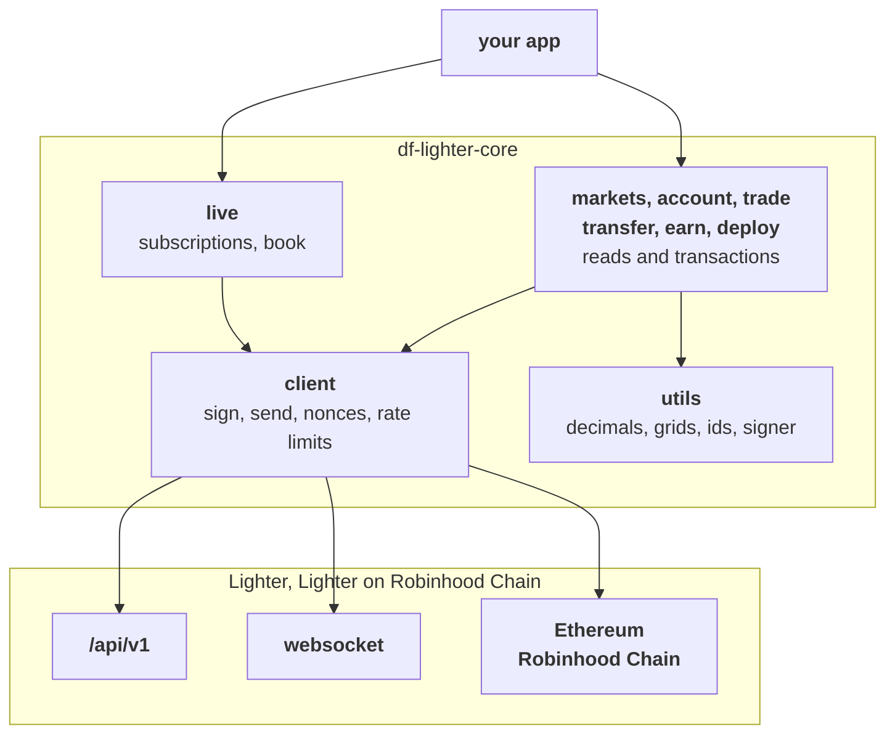

<p align="center">
  <a href="https://dfurrer.com">
    <picture>
      <source media="(prefers-color-scheme: dark)" srcset="https://dfu-cl-storybook.pages.dev/brand/markdfu-raised.svg">
      
    </picture>
  </a>
</p>

# df-lighter-core

Rust SDK for [Lighter](https://lighter.xyz), on Lighter and on Lighter on Robinhood Chain: markets, trading, transfers, pools and binary options in one crate, with exact decimals, the API key signer in Rust and native or wasm transports.

## SDK

```text
df-lighter-core
├── client          the Client, the two networks, rate limits
│   ├── http        the REST API, the wire, sendTx, the limit gate
│   ├── evm         the L1: JSON-RPC, EIP-1559 transactions, ABI, the ZkLighter contract
│   ├── native      reqwest and tokio-tungstenite (feature native)
│   └── web         fetch and WebSocket (feature web)
├── markets         what is listed and what it trades at
│   ├── books       perps and spot pairs, their details and grids
│   ├── book        resting orders, depth, a taker's walk
│   ├── trades      the tape and trade history
│   ├── candles     trade and mark price candles
│   ├── funding     hourly settlements, current rates
│   ├── assets      assets, tokens, oracles
│   ├── stats       exchange stats, metrics, fee tiers
│   ├── system      system config, contract, L1, announcements
│   └── binary      binary options events
├── account         what an account holds and who may sign for it
│   ├── holdings    the account, positions, balances, pool shares, an owner's accounts
│   ├── history     orders, fills, transactions, PnL, funding, liquidations
│   ├── keys        API keys, auth tokens, the owner's wallet, registering a key
│   └── settings    sub-accounts, trading mode, integrators, tier, read tokens, referrals
├── trade           orders on every market
│   ├── orders      limit, market, stop, take-profit, TWAP, grouped, client indexes
│   ├── manage      cancel, cancel all, modify
│   └── margin      leverage, isolated margin
├── transfer        transfers, secure and fast withdrawals, deposits through the L1, history
├── earn            public pools and the LLP, LIT staking, fee credits
├── deploy          binary options markets an operator creates, updates and settles
├── live            websocket subscriptions, frames, connection state, the kept book
└── utils           decimals, grids, ids, units, time, nonces, Poseidon2, ECgFp5, Schnorr
```



## Examples

| Example | What it does |
|---|---|
| `cargo run -p df-lighter-core --example market_order` | Reads BTC's details and book from Lighter (or `-- robinhood`), prints the unsigned market order for a $20 buy |

## Tests

```text
packages/core
├── src/**/tests       unit: decimals, grids, encoding, signing, refusals, every read on its recording
├── tests
│   ├── conformance    every transaction, auth token and L1 call matches lighter-go and go-ethereum
│   ├── mocked         whole journeys through Client against a fake venue that checks every signature
│   └── live           both networks, read only: every public read and L1 read
├── fixtures           recorded venue answers, both networks
└── vectors            what lighter-go and go-ethereum produce, and the program that made them
```

| Command | What it runs |
|---|---|
| `just check` | format, lint, unit, conformance, mocked, the browser transport in Node, docs |
| `just live` | the live suite against both networks, each answer held against its recording |
| `just cover` | line coverage of everything but the live suite |

<br>

<p align="center">
  <sub><sub><a href="https://dfurrer.com">DFU</a></sub></sub>
  &emsp;&emsp;&emsp;
  <sub><a href="https://dfurrer.com">dfurrer.com</a></sub>
  &emsp;&emsp;&emsp;
  <sub><sub><a href="https://dfurrer.com">df.lighter</a></sub></sub>
</p>
